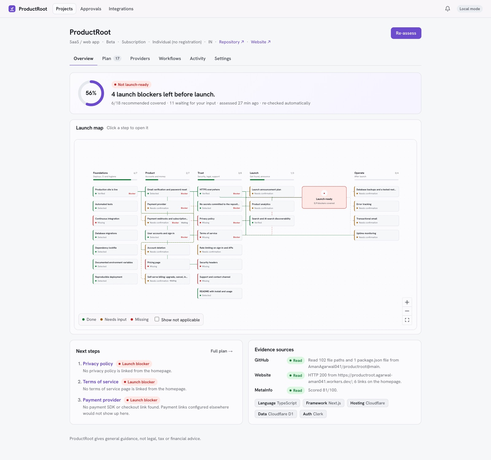
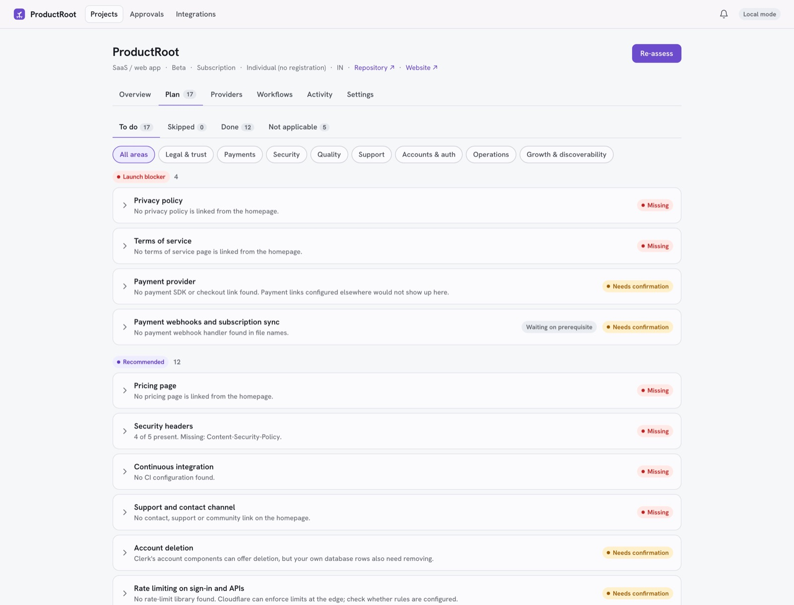
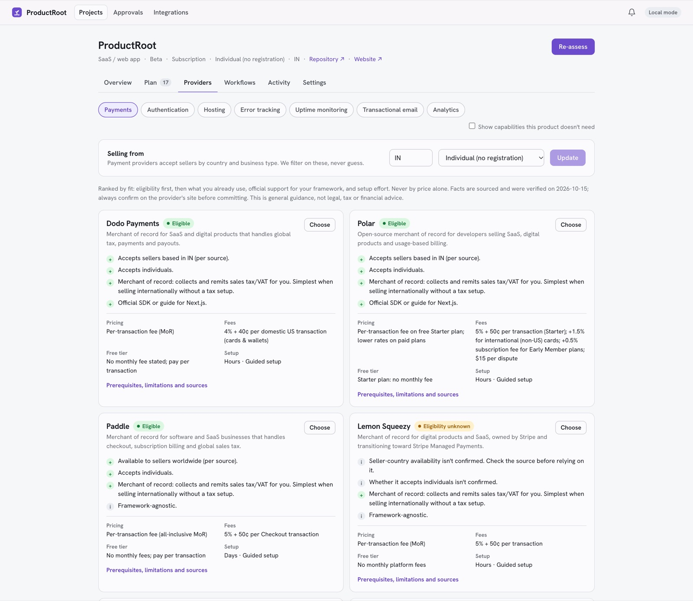
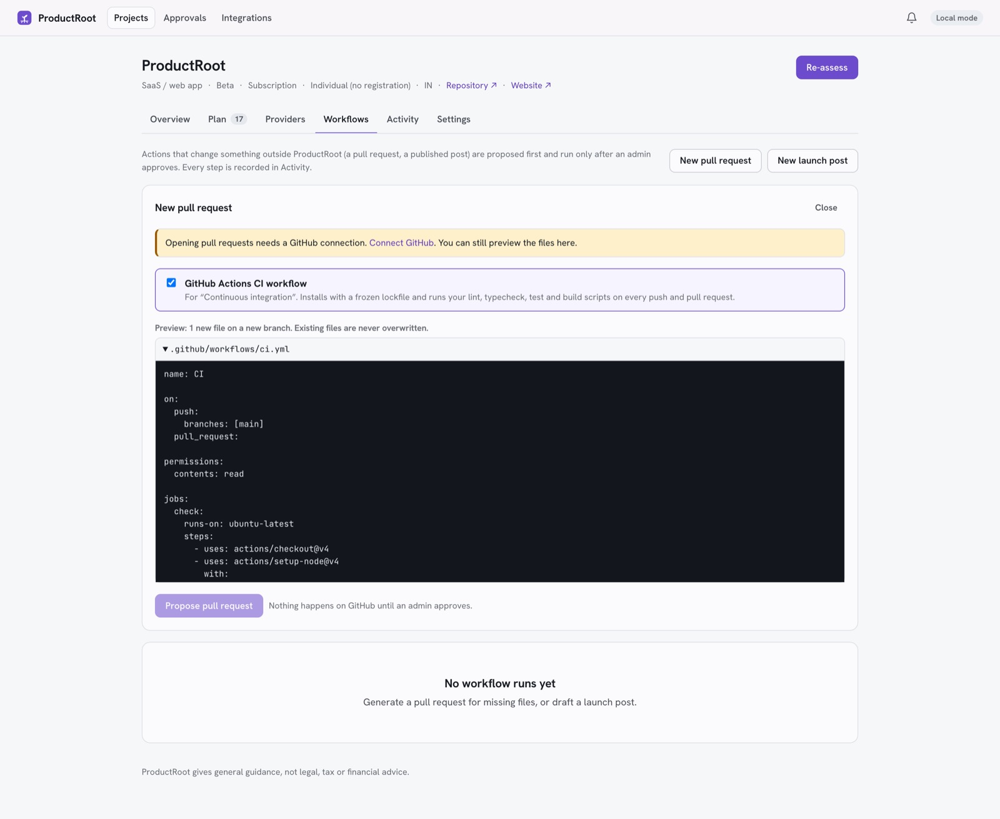
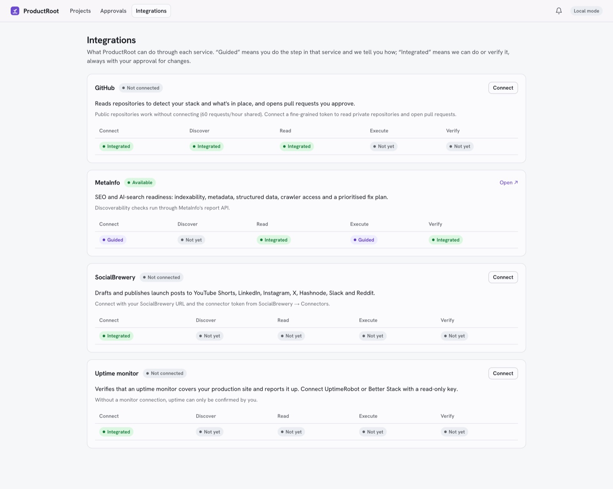

<p align="center">
  
</p>

<h1 align="center">ProductRoot</h1>

<p align="center">
  <strong>You built the product. Now get it launched.</strong><br/>
  ProductRoot reads your repository and production site, finds what's missing before launch, recommends tools that fit your stack and country, and does the repeatable work with your approval.
</p>

<p align="center">
  <a href="https://productroot.agarwal-aman041.workers.dev"><b>Try it live →</b></a> ·
  <a href="#features">Features</a> ·
  <a href="#run-it-yourself">Run it yourself</a> ·
  <a href="docs/AUDIT.md">Design notes</a>
</p>

<p align="center">
  
</p>

## Why

After the code works, there's still a long list of things to sort out:
- authentication, payments and webhooks;
- privacy policy and terms;
- deploys, backups and monitoring;
- security headers, discoverability, and a launch announcement.

Guidance is scattered and generic. ProductRoot looks at **your** product, decides what applies to it, and tells you what's a launch blocker, what's recommended and what's optional, with the evidence behind each finding.

## How it works

1. **Connect:** add a GitHub repository and your production URL. Access is read-only: file paths, `package.json` and your homepage.
2. **Assess:** 34 deterministic checks across accounts, payments, legal, security, infrastructure, quality, operations, growth and open source.
3. **Plan:** a prioritised plan for your product type, stage and business model, shown on a launch map that leads through a *Launch-ready* gate.
4. **Act and verify:** compare providers, open pull requests and publish launch posts, each only after an admin approves. Scheduled re-checks catch regressions.

## Features

| | |
|---|---|
|  | **A plan grounded in evidence**<br/>Each item explains why it matters, what to do and how to verify it, and shows what we found. Findings are *verified*, *detected*, *confirmed*, *needs confirmation* or *missing*; never a checkmark without a reason. |
|  | **Providers that fit**<br/>26 sourced providers across payments, auth, hosting, error tracking, uptime, email and analytics. Payment eligibility is filtered by seller country and business type and never guessed. Every fact links to the official page, with a verified date. |
|  | **Automation with a human in the loop**<br/>Generate a CI workflow, LICENSE, SECURITY.md, contributing guide, issue templates or changelog, and preview the exact files. Approved runs open a PR on a new branch, never overwrite files, and are idempotent. |
|  | **Honest integrations**<br/>GitHub (private repos and PRs), [MetaInfo](https://github.com/AmanAgarwal041/metainfo) (SEO and AI-search readiness), [SocialBrewery](https://github.com/AmanAgarwal041/socialbrewery) (launch posts), and UptimeRobot or Better Stack (uptime verification). Each one shows what it can really do. Credentials are encrypted per workspace. |

Also included:
- scheduled re-checks with regression notifications;
- an approvals inbox and a full audit log;
- personal and team workspaces on Clerk;
- read-only by default, storing derived evidence only, never your code or HTML.

## Part of a product family

- **[MetaInfo](https://metainfo.agarwal-aman041.workers.dev):** see any page the way Google, Bing, ChatGPT, Perplexity, Claude and Gemini do.
- **[SocialBrewery](https://socialbrewery.agarwal-aman041.workers.dev):** an AI posting studio for YouTube Shorts, LinkedIn, Instagram, X, Hashnode, Slack and Reddit.
- **ProductRoot** reuses both through their real APIs, and one sign-in works across all three.

---

# Run it yourself

## What's built (Milestones 1–6)

**Assess and plan (M1–2)**
- **Projects:** each project has a repository and/or production URL, product type, stage, monetisation, country, business type and an automatic re-check toggle. Projects are scoped to the Clerk organisation or personal workspace.
- **Assessment:** reads three sources in parallel; a source that fails never fails the run.
  - GitHub: file tree plus `package.json`. Private repos work once the workspace connects GitHub.
  - Website: status, final URL, security headers, links and scripts, behind an SSRF guard.
  - MetaInfo: `/api/report?format=summary`.
  - Uptime monitors, when one is connected.
- **34 deterministic checks.** Evidence states are verified, detected, confirmed, needs confirmation, missing and not applicable.
- **Priorities follow the context** and are recomputed on read. Decisions (done, skip, not applicable, reopen) survive re-assessment, and a regression reopens a task.

**Providers (M3)**
- **Sourced catalog:** 26 providers across payments, auth, hosting, error tracking, uptime, email and analytics (`lib/core/catalog-data.ts`). Every changeable fact links to the official page it came from, and each provider has a `verifiedAt` date. Entries older than 90 days are flagged.
- **Deterministic comparison:**
  - Eligibility by seller country and business type. Unknown facts show as "unknown"; they're never guessed.
  - Fit: already in your code, official SDK for your framework, merchant-of-record status, and setup effort.
  - Price is shown but never used alone to rank.
- **Choices:** you can record the provider you pick for each capability.

**Connections and integrations (M4)**
- **Per-workspace connections**, encrypted with AES-256-GCM using the workspace and provider as AAD, and removable at any time:
  - GitHub: fine-grained token for private repos and pull requests.
  - SocialBrewery: URL plus MCP connector token.
  - UptimeRobot (v3 API) or Better Stack: read-only key.
- **Credentials are checked with the provider before they're stored**, and the browser never sees them again.

**Workflows with approvals (M5)**
- **Pull requests:** generators (CI workflow, LICENSE, SECURITY.md, CONTRIBUTING.md, issue templates, CHANGELOG) preview their exact files before you propose.
  - An approved run opens a PR on a new `productroot/*` branch.
  - It never overwrites a file and never touches the default branch.
  - It's idempotent per branch, so failed runs can be retried safely.
- **SocialBrewery posts:** forms are generated from the tool's JSON schema. Posts run exactly once after approval and are **never** retried, because SocialBrewery has no idempotency keys.
- **Every transition is an audited compare-and-set update.** Only admins approve.
- **Approvals inbox** for the whole workspace.

**Post-launch operations (M6)**
- **Scheduled re-checks:** the Workers cron runs `worker.ts` → `/api/cron/recheck`, which re-assesses stale projects. A check that was verified or detected and is now missing raises a notification.
- **Uptime verification:** a connected monitor must cover the production host and report it up.
- **In-app notifications** for regressions, approvals, and failed or finished runs.

**UI**
- **Launch map:** an xyflow diagram of the plan. Phases run Foundations → Product → Trust → Launch, then a Launch-ready gate fed by every blocker, then Operate. Dependency edges are coloured by whether the path is clear, and clicking a node opens its task.
- **Project workspace tabs:** Overview, Plan, Providers, Workflows, Activity and Settings.

Not yet done:
- A GitHub App flow; fine-grained tokens are used instead.
- Email or Slack delivery of notifications.
- Payment and product-usage metrics.
- AI-written explanations; all findings are deterministic.

## Stack

Same as MetaInfo: Next 16 + React 19 on Cloudflare Workers via OpenNext, D1, and Clerk. Styling is plain CSS tokens shared with MetaInfo, using a violet accent. Tests use Vitest.

## Develop

```bash
npm install
cp .env.example .env.local     # all optional for local use
npm run db:migrate:local       # creates the local D1 under .wrangler/state
npm run dev
```

Without Clerk keys, `next dev` runs as a single local user ("Local mode"); production refuses unauthenticated requests. Set `METAINFO_URL` to include discoverability checks, and `GITHUB_TOKEN` to raise GitHub's 60 requests/hour anonymous limit.

```bash
npm test          # vitest: checks, plan, catalog, generators, workflows, launch map, PR flow (mocked)
npm run typecheck
npm run lint
```

## Deploy

```bash
npx wrangler d1 create productroot   # paste the id into wrangler.jsonc
npm run db:migrate:remote
npx wrangler secret put CLERK_SECRET_KEY
npx wrangler secret put PRODUCTROOT_MASTER_KEY   # encrypts connections; `openssl rand -base64 32`
npx wrangler secret put CRON_SECRET              # guards /api/cron/recheck
# optional: GITHUB_TOKEN (anonymous fallback for public repos), METAINFO_TOKEN
npm run deploy
```

Live at https://productroot.agarwal-aman041.workers.dev (D1 `productroot`, APAC; cron every 2 hours).

Put `NEXT_PUBLIC_CLERK_PUBLISHABLE_KEY` (and, for convenience, `CLERK_SECRET_KEY`) in the git-ignored `.env.production`. The publishable key is inlined at build time. `scripts/cf-sanitize-env.mjs` strips everything else from the build output, so the secret key must also be set with `wrangler secret put`. On `*.workers.dev`, use the Clerk Development instance keys (`pk_test_`/`sk_test_`): production instances need a domain you own. Use the same Clerk application as MetaInfo and SocialBrewery for one sign-in across the family, and add ProductRoot's origin to its allowed origins.

## Layout

```
lib/core/       pure domain logic (checks, plan, catalog, generators, workflow state machine, launch-map layout): unit tested
lib/server/     auth (Clerk), D1 store, safe fetch, collectors, encrypted connections, adapters, workflows, notifications
worker.ts       Worker entry: OpenNext fetch handler + cron trigger
app/api/        JSON route handlers
app/, components/  UI
migrations/     D1 schema
test/           Vitest
```
